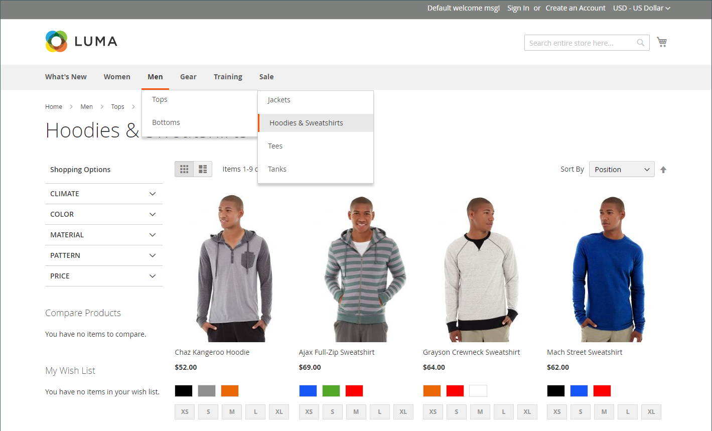

# Navegação no catálogo

O termo _navegação_ se refere aos métodos que os compradores usam para mover de página para página em toda a sua loja. O menu principal, ou navegação superior, da sua loja é, na verdade, uma lista de links de categoria e fornece acesso fácil aos produtos em seu catálogo. Também há categorias na trilha de navegação estrutural que aparece na parte superior da maioria das páginas e na navegação em camadas que aparece no lado esquerdo de algumas páginas de duas ou três colunas. Para obter mais informações sobre opções de exibição de categoria, consulte [Configurações de exibição](categories-display-settings.md).

Para que um produto seja visível em sua loja, ele deve ser atribuído a pelo menos uma categoria (consulte [Definir a navegação superior](navigation-top.md)). Cada categoria pode ter uma página de aterrissagem dedicada com uma imagem, bloco estático, uma descrição e uma lista de produtos na categoria. Você também pode criar designs especiais para páginas de categoria que estão ativas somente por um período específico, como para um feriado ou promoção.

{width="700" zoomable="yes"}
