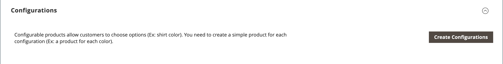

# Configurações do produto - [!UICONTROL Configurations]

A seção _[!UICONTROL Configurations]_lista todas as variações existentes do produto e pode ser usada para gerar variações para uso com o tipo de produto Configurável. Para obter mais informações, consulte [Produto configurável](product-create-configurable.md).

{width="600" zoomable="yes"}

{width="600" zoomable="yes"}

## Referência do campo

| Campo | Descrição |
|--- |--- |
| [!UICONTROL Image] | Imagem do produto |
| [!UICONTROL Name] | O nome exclusivo de um produto |
| [!UICONTROL SKU] | Com base no nome do produto |
| [!UICONTROL Price] | Preço do produto |
| [!UICONTROL Quantity] | Valores de estoque disponíveis para cada produto |
| [!UICONTROL Weight] | O peso do produto |
| [!UICONTROL Status] | Status do produto **[!UICONTROL Enabled]** / **[!UICONTROL Disabled]** |
| [!UICONTROL Attributes] | Um conjunto de atributos usados para descrever um produto |
| [!UICONTROL Actions] | Lista todas as ações que podem ser aplicadas aos produtos selecionados. Ações:  **[!UICONTROL Choose a different Product]** - Remove e substitui o produto atual pela nova seleção.  **[!UICONTROL Disable Product]** / **[!UICONTROL Enable Product]** - Desabilita ou habilita o produto selecionado.  **[!UICONTROL Remove Product]** - Remove o produto selecionado da configuração atual. |

{style="table-layout:auto"}
