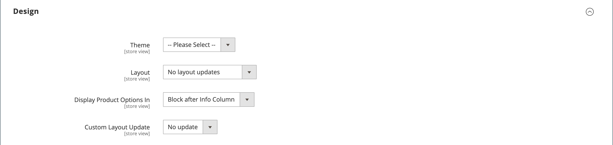

# Configurações do produto - [!UICONTROL Design]

As configurações de _[!UICONTROL Design]_permitem que um tema diferente seja aplicado à página do produto, alteram o layout da coluna, determinam onde as opções do produto são exibidas e inserem o código XML personalizado.

{width="600" zoomable="yes"}

>[!NOTE]
>
>Quando o mesmo produto é atribuído a várias categorias com configurações de design diferentes para cada categoria, é recomendável definir **[!UICONTROL Use Categories Path for Product URLs]** = `Yes` nas [opções de configuração de Otimização do Mecanismo de Pesquisa](../configuration-reference/catalog/catalog.md#search-engine-optimization). Para acessar esta configuração, vá para **[!UICONTROL Stores]** > _[!UICONTROL Settings]_>**[!UICONTROL Configuration]**, expanda **[!UICONTROL Catalog]**e escolha **[!UICONTROL Catalog]**abaixo no painel esquerdo e, em seguida, expanda a seção **[!UICONTROL Search Engine Optimization]**na página.

| Campo | [Escopo](../getting-started/websites-stores-views.md#scope-settings) | Descrição |
|---|---|----|
| [!UICONTROL Theme] | Exibição da loja |  (somente Adobe Commerce) Oferece a capacidade de aplicar um tema diferente ao produto. Opções: (todos os temas disponíveis) |
| [!UICONTROL Layout] | Exibição da loja | Oferece a capacidade de aplicar um [layout](../content-design/page-layout.md) diferente à página do produto. Opções:  **[!UICONTROL No layout updates]**- Por padrão, as atualizações de layout não estão disponíveis para a página do produto. **[!UICONTROL Empty]** - Permite definir seu próprio layout, como uma página de 4 colunas. (Requer compreensão de XML.)  **[!UICONTROL 1 column]**- Aplica um layout de uma coluna à página do produto. **[!UICONTROL 2 columns with left bar]** - Aplica um layout de duas colunas com uma barra lateral esquerda à página do produto.  **[!UICONTROL 2 columns with right bar]**- Aplica um layout de duas colunas com uma barra lateral direita à página do produto. **[!UICONTROL 3 columns]** - Aplica um layout de três colunas à página do produto.  **[!UICONTROL Page -- Full Width]**- (Requer [[!DNL Page Builder]](../page-builder/introduction.md)) Aplica o layout de largura total das páginas do CMS à página do produto. **[!UICONTROL Category -- Full Width]** - (Requer [!DNL Page Builder]) Aplica o layout de largura total das páginas de categoria à página do produto.  **[!UICONTROL Product -- Full Width]**- (Requer [!UICONTROL Page Builder]) Aplica o layout de largura total das páginas do produto à página do produto. |
| [!UICONTROL Display Product Options In] | Exibição da loja | Determina onde as opções do produto são exibidas na página do produto. Opções: `Product Info Column` / `Block after Info Column` |
| [!UICONTROL Custom Layout Update] | Exibição da loja | Usado para acessar opções para atualizar um layout personalizado na página do produto. |

{style="table-layout:auto"}

