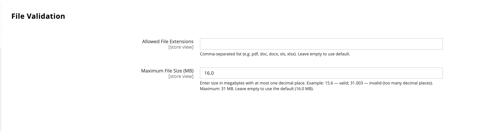

# [!UICONTROL Catalog] > [!UICONTROL Product File Attributes]

{{config}}

## [!UICONTROL Configure Allowed File Types and Size]

| Campo | [Escopo](../../getting-started/websites-stores-views.md#scope-settings) | Descrição |
|--- |--- |--- |
| [!UICONTROL Allowed File Extensions] | Global | Uma lista separada por vírgulas de tipos de arquivos permitidos, como `pdf,doc,docx,txt`. Deixe em branco para usar os tipos de arquivo padrão permitidos: pdf, doc, docx, xls, xlsx, ppt, pptx, txt, csv, zip. |
| [!UICONTROL Maximum File Size] | Global | O tamanho máximo de arquivo permitido em MB, como `20.0`. O limite padrão é de 16 MB. O tamanho máximo permitido do arquivo é 31 MB. |

{style="table-layout:auto"}
