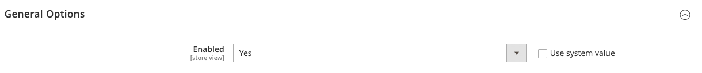
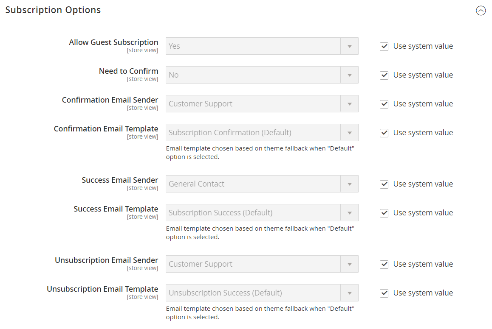

# [!UICONTROL Customers] > [!UICONTROL Newsletter]

{{config}}

>[!NOTE]
>
>O informativo faz parte de instrumentos de marketing que permitem enviar notícias, descontos e outros emails de marketing aos clientes. Os clientes registrados podem gerenciar sua assinatura no [painel de conta](../../customers/account-dashboard-my-account.md).

## [!UICONTROL General Options]

<!-- zoom -->

| Campo | [Escopo](../../getting-started/websites-stores-views.md#scope-settings) | Descrição |
|--- |--- |--- |
| [!UICONTROL Enabled] | Exibição da loja | Determina se os boletins informativos estão habilitados para o escopo de exibição da loja. Opções: `Yes` / `No` |

{style="table-layout:auto"}

## [!UICONTROL Subscription Options]

<!-- zoom -->

<!-- [Subscription Options](https://experienceleague.adobe.com/pt-br/docs/commerce-admin/marketing/communications/newsletters/newsletters) -->

| Campo | [Escopo](../../getting-started/websites-stores-views.md#scope-settings) | Descrição |
|--- |--- |--- |
| [!UICONTROL Allow Guest Subscription] | Exibição da loja | Determina se os convidados não registrados podem assinar um boletim informativo. Opções: `Yes` / `No` |
| [!UICONTROL Need to Confirm] | Exibição da loja | Determina se as solicitações de assinatura devem ser confirmadas. Esse método de aceitação dupla é uma medida de validação que impede as pessoas de serem inscritas sem o consentimento. Opções: `Yes` / `No` |
| [!UICONTROL Confirmation Email Sender] | Exibição da loja | Identifica o contato da loja que aparece como o remetente do email enviado para confirmar uma solicitação de assinatura. |
| [!UICONTROL Confirmation Email Template] | Exibição da loja | Determina o template de email usado para a notificação enviada para confirmar uma solicitação de assinatura de um boletim informativo. Modelo padrão: `Newsletter subscription confirmation` |
| Remetente do email de sucesso | Exibição da loja | Identifica o contato da loja que aparece como o remetente do email enviado para aqueles que assinam um boletim informativo com êxito. |
| [!UICONTROL Success Email Template] | Exibição da loja | Determina o template de email usado para a notificação enviada àqueles que assinam um boletim informativo com êxito. Modelo padrão: `Newsletter subscription success` |
| [!UICONTROL Unsubscription Email Sender] | Exibição da loja | Identifica o contato da loja que aparece como o remetente do email enviado para aqueles que solicitam o fim da assinatura do boletim informativo. |
| [!UICONTROL Unsubscription Email Template] | Exibição da loja | Determina o template de email usado para a notificação enviada àqueles que solicitam o fim da assinatura do boletim informativo. Modelo padrão: `Newsletter unsubscription success` |

{style="table-layout:auto"}
