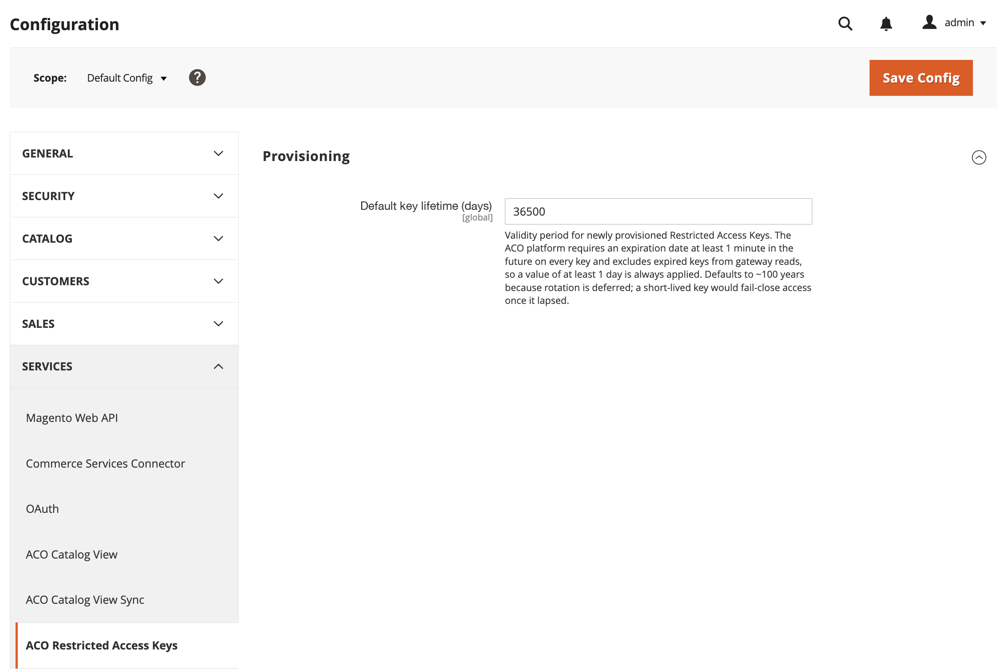

# [!UICONTROL Services] > [!UICONTROL ACO Restricted Access Keys]

Use essa configuração para controlar o período de expiração padrão que o [!DNL Adobe Commerce Optimizer Connector for B2B] aplica às chaves de acesso restritas que ele provisiona para exibições de catálogo compartilhado B2B. Para criar, atribuir e excluir essas chaves, consulte [Gerenciamento de Chaves de Acesso Restrito](../../systems/restricted-access-keys.md).

>[!NOTE]
>
>Esta página se aplica ao conector. As instâncias provisionadas com o Composable Catalog Data Model (CCDM) sincronizam dados nativamente e não usam o conector. Consulte [Serviços de merchandising com CCDM](/help/optimizer/overview.md).

{{config}}

## [!UICONTROL Provisioning]

<!-- zoom -->

| Campo | [Escopo](../../getting-started/websites-stores-views.md#scope-settings) | Descrição |
| --- | --- | --- |
| [!UICONTROL Default key expiry (days)] | Global | Período de validade para chaves de acesso restrito recém-provisionadas. [!DNL Adobe Commerce Optimizer] requer uma data de expiração de pelo menos um minuto em cada chave e exclui chaves expiradas das leituras de gateway, portanto, um valor de pelo menos um dia é sempre aplicado. Valor padrão: `36500` |

{style="table-layout:auto"}

>[!NOTE]
>
>A expiração padrão está definida como um período de expiração longo porque a rotação de chaves automática ainda não está disponível. Consulte [Seleção e rotação de chaves](../../systems/restricted-access-keys.md#key-selection-and-rotation).

>[!MORELIKETHIS]
>
> - [Exibição do Catálogo ACO](./aco-catalog-view.md) — Configure os tokens de acesso de vitrine para exibições de catálogo
> - [Gerenciamento de Chaves de Acesso Restrito](../../systems/restricted-access-keys.md) — Criar, atribuir e excluir chaves de acesso restrito
> - [Monitoramento do Status de Sincronização da Exibição de Catálogo](../../systems/catalog-view-sync-status.md) — Monitorar chaves perto da expiração
