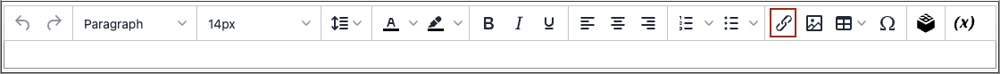

# Inserir um link no editor

Uma maneira fácil de inserir um link é usar o botão _Link_ na barra de ferramentas do [editor](editor.md). Não requer conhecimento sobre o HTML e o resultado é o mesmo.

1. Selecione o texto no qual deseja criar o link.

1. Clique no ícone _Inserir/editar link_ na barra de ferramentas do editor.

   {width="700" zoomable="yes"}

   Esta ação abre a caixa de diálogo _[!UICONTROL Insert link]_.

   {width="250" zoomable="yes"}

1. Para **[!UICONTROL Url]**, insira um dos seguintes:

   - A chave do URL de uma página em sua loja.

   - O URL completo de uma página externa a ser vinculada.

1. Se necessário, modifique o **[!UICONTROL Text to display]**.

   O padrão é o texto selecionado para o link. Você pode alterá-lo na caixa de texto.

1. Para **[!UICONTROL Title]**, insira o texto da dica de ferramenta a ser exibida quando alguém passar o mouse sobre o link.

1. Defina **[!UICONTROL Target]** como um dos seguintes:

   - `Open link in the same window`

   - `Open in a new window`

1. Para criar o link, clique em **[!UICONTROL OK]**.
