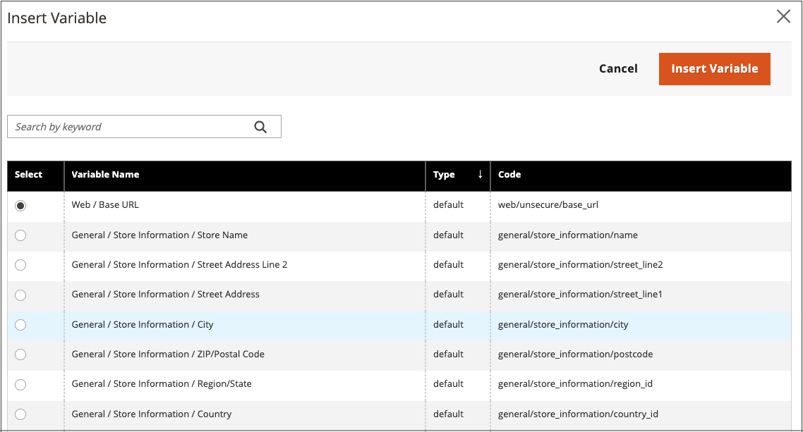

# Inserir uma variável no editor

Seu armazenamento inclui muitas [variáveis](../systems/variables-predefined.md) predefinidas que podem ser incorporadas ao conteúdo da página e a outras comunicações. Além disso, você pode incluir suas próprias [variáveis personalizadas](../systems/variables-custom.md) específicas para suas necessidades.

1. Abra uma página, um bloco ou um bloco dinâmico no modo de edição.

1. Vá para a seção _[!UICONTROL Content]_&#x200B;e clique em qualquer elemento compatível com o editor.

1. Posicione o cursor onde deseja que a variável apareça e clique no ícone _Inserir variável_.

   {width="700" zoomable="yes"}

   Se você não tiver o [!UICONTROL Page Builder] habilitado e preferir trabalhar com o código HTML, clique em **[!UICONTROL Show / Hide Editor]**. Posicione o ponto de inserção no texto no qual você deseja que a variável apareça. Em seguida, clique em **[!UICONTROL Insert Variable]**.

1. Na lista de variáveis disponíveis, escolha a que você deseja e clique em **[!UICONTROL Insert Variable]**.

   {width="600" zoomable="yes"}

1. Quando as edições de conteúdo forem concluídas, clique em **[!UICONTROL Save]**.
