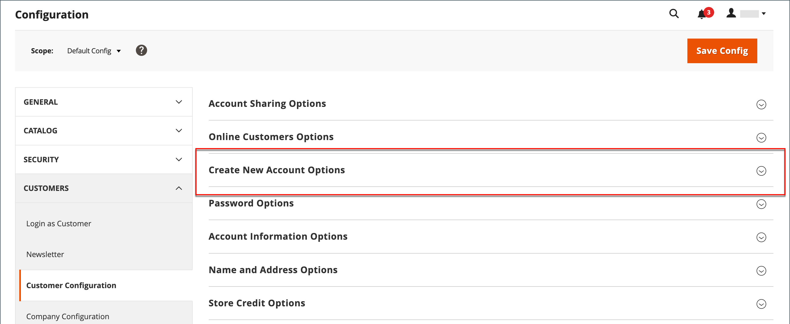
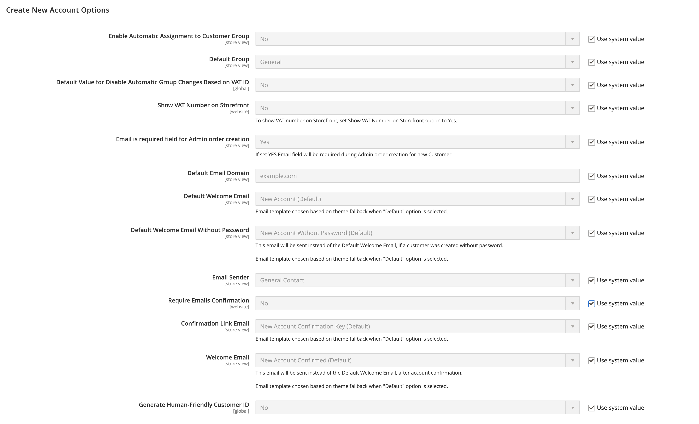
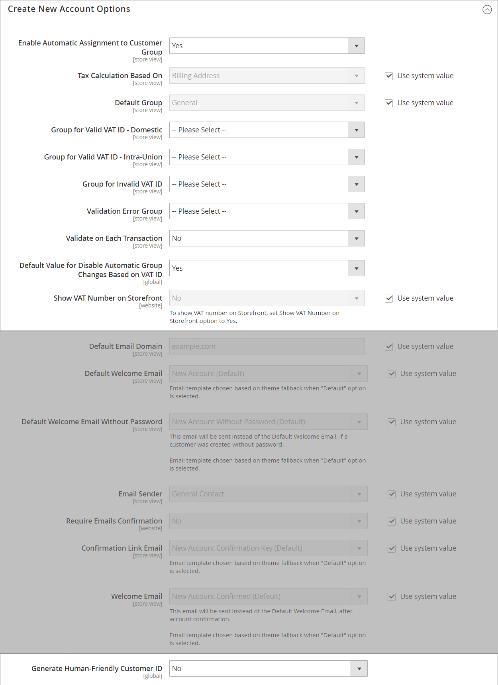

# Novas opções de conta de cliente

Na seção _[!UICONTROL Create New Account Options]_da configuração, as opções básicas da conta são combinadas com opções mais avançadas relacionadas à Validação de ID de IVA e às integrações personalizadas. As instruções a seguir abordam apenas as opções usadas com mais frequência. Para saber mais sobre atribuições automáticas de grupo de clientes, consulte [Validação de VAT](../stores-purchase/vat.md).

{width="600" zoomable="yes"}

## Configurar as opções básicas de conta de cliente

1. Na barra lateral _Admin_, vá para **[!UICONTROL Stores]** > _[!UICONTROL Settings]_>**[!UICONTROL Configuration]**.

1. No painel esquerdo, expanda **[!UICONTROL Customers]** e escolha **[!UICONTROL Customer Configuration]**.

1. Expanda a seção **[!UICONTROL Create New Account Options]**:

   {width="600" zoomable="yes"}

1. Defina cada uma das opções de acordo com a experiência do cliente que você precisa para oferecer suporte na loja:

   - Defina **[!UICONTROL Default Group]** para o grupo de clientes que é atribuído a novos clientes quando uma conta é criada.

   - Se você tiver um número de _Imposto sobre Valor Agregado_ e desejar que ele fique visível para os clientes, defina **[!UICONTROL Show VAT Number on Storefront]** como `Yes`.

   - Para solicitar o email de um cliente durante a criação do pedido de Admin para um cliente, defina **[!UICONTROL Email is required field for Admin order creation]** como `Yes`.

   - Insira o **[!UICONTROL Default Email Domain]** para o armazenamento, como `mystore.com`

   - Defina **[!UICONTROL Default Welcome Email]** com o modelo usado para o email de boas-vindas enviado a novos clientes.

   - Para exigir que os clientes confirmem sua solicitação para abrir uma conta em seu armazenamento, defina **[!UICONTROL Require Emails Confirmation]** como `Yes`. Em seguida, defina **[!UICONTROL Confirmation Link Email]** como o modelo usado para o email de confirmação.

     >[!NOTE]
     >
     >A partir da versão 2.4.7, os clientes devem inserir novamente seu email e senha para fazer logon em sua conta após a confirmação por email, independentemente do navegador.

   - Defina **[!UICONTROL Welcome Email]** com o modelo usado para a mensagem de boas-vindas enviada depois que a conta for confirmada.

   - Defina **[!UICONTROL Default Welcome Email without Password]** com o modelo que é usado quando uma conta de cliente que ainda não tem uma senha é criada. Por exemplo, uma conta de cliente criada a partir do Administrador ainda não tem uma senha atribuída.

   - Defina **[!UICONTROL Email Sender]** para o contato de armazenamento que aparece como remetente do email de boas-vindas.

   - Para exigir que os clientes confirmem sua solicitação para abrir uma conta em seu armazenamento, defina **[!UICONTROL Require Emails Confirmation]** como `Yes`. Em seguida, defina **[!UICONTROL Confirmation Link Email]** como o modelo usado para o email de confirmação.

   {width="600" zoomable="yes"}

   Para obter informações detalhadas sobre cada uma das opções disponíveis neste conjunto de opções de configuração, consulte a _Referência de configuração de [Criar Novas Opções de Conta_](../configuration-reference/customers/customer-configuration.md).

1. Quando terminar, clique em **[!UICONTROL Save Config]**.
