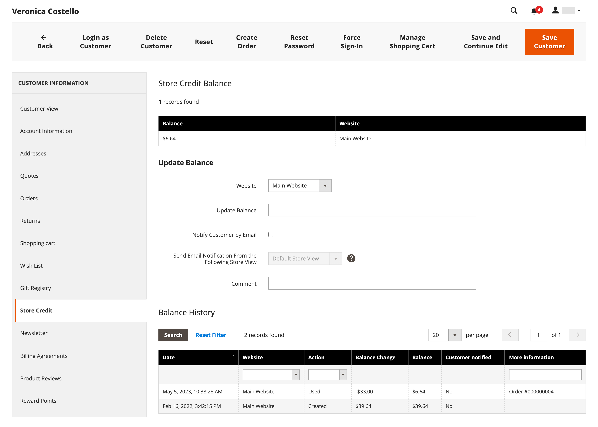
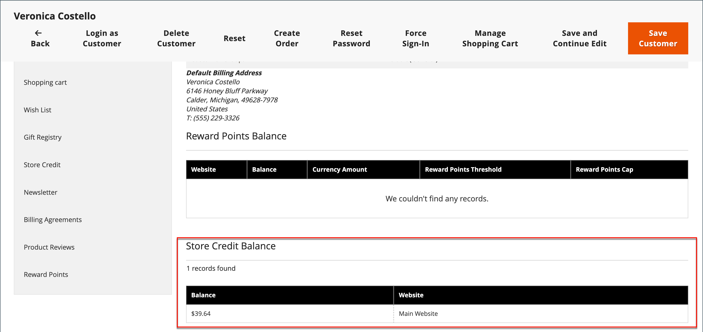

# Aplicar crédito da loja

{{ee-feature}}

Os administradores de loja podem exibir o saldo e o histórico de crédito da conta do cliente e também aplicar crédito de loja a uma compra.

{width="600" zoomable="yes"}

## Armazenar recursos de função de crédito

[!BADGE Somente SaaS]{type=Positive url="https://experienceleague.adobe.com/pt-br/docs/commerce/user-guides/product-solutions" tooltip="Aplicável somente a projetos do Adobe Commerce as a Cloud Service (infraestrutura SaaS gerenciada pela Adobe)."}

Os recursos a seguir determinam quais usuários Administradores podem alterar o saldo de crédito de armazenamento de um cliente e quais usuários podem aplicar crédito de armazenamento a um pedido. Para obter informações sobre como atribuir recursos a uma função de usuário, consulte [Recursos de função](../systems/permissions-user-roles.md#role-resources).

- **[!UICONTROL Customers]** > **[!UICONTROL All Customers]** > **[!UICONTROL Manage Store Credit Balances]** permite que os usuários exibam e atualizem saldos de crédito de armazenamento. Sem ele, a guia **[!UICONTROL Store Credit]** e o **[!UICONTROL Store Credit Balance]** na guia **[!UICONTROL Customer View]** não ficam visíveis. O usuário ainda pode fazer outras edições nas contas do cliente.

- **[!UICONTROL Sales]** > **[!UICONTROL Operations]** > **[!UICONTROL Orders]** > **[!UICONTROL Actions]** > **[!UICONTROL Create]** > **[!UICONTROL Can Spend Store Credit]** permite que os usuários apliquem crédito de armazenamento ao [criar um pedido](../stores-purchase/customer-account-create-order.md). Sem ela, a caixa de seleção **[!UICONTROL Use Store Credit]** não fica visível.

Os usuários administradores e as integrações que usam a REST API precisam do recurso **[!UICONTROL Can Spend Store Credit]** para aplicar crédito de armazenamento a um carrinho ou para fazer um pedido de um carrinho que já tenha crédito de armazenamento aplicado. Para obter mais informações, consulte [Crédito da loja](https://developer.adobe.com/commerce/webapi/rest/saas-integrations/store-credit/).

## Exibir o saldo de crédito

1. Na barra lateral _Admin_, vá para **[!UICONTROL Customers]** > **[!UICONTROL All Customers]**.

1. Encontre o cliente na grade.

1. Na coluna _Ação_, clique em **[!UICONTROL Edit]**.

1. Role a página _[!UICONTROL Customer View]_&#x200B;e exiba **[!UICONTROL Store Credit Balance]**&#x200B;na parte inferior.

{width="600" zoomable="yes"}

## Atualizar saldo de crédito da loja

1. Na barra lateral _Admin_, vá para **[!UICONTROL Customers]** > **[!UICONTROL All Customers]**.

1. Encontre o cliente na grade.

1. Na coluna _Ação_, clique em **[!UICONTROL Edit]**.

1. No painel esquerdo, escolha **[!UICONTROL Store Credit]**.

1. Escolha o site (vitrine) que deseja associar ao saldo.

1. Para **[!UICONTROL Update Balance]**, insira o novo valor.

1. Para notificar o cliente sobre a atualização do saldo, marque a caixa de seleção **[!UICONTROL Notify Customer by Email]** e escolha o modo de exibição de loja em **[!UICONTROL Send Email Notification From the Following Store View]**.

1. Digite um **[!UICONTROL Comment]** sobre a alteração.

1. Quando as atualizações estiverem concluídas, clique em **[!UICONTROL Save and Continue Edit]** ou **[!UICONTROL Save Customer]**.

O saldo atualizado deve ser exibido em **[!UICONTROL Balance History]**.

## Aplicar um saldo de crédito a uma ordem como administrador de armazenamento

Como administrador de loja, você pode fazer várias coisas em nome de um cliente, incluindo o envio de pedidos. Ao [criar um pedido](../stores-purchase/customer-account-create-order.md), você pode aplicar um saldo de Crédito da Loja que é devido ao cliente. O saldo disponível é exibido na seção _Informações de Pagamento e Envio_. Marque a caixa de seleção **[!UICONTROL Use Store Credit]** para aplicar o saldo ou uma parte do saldo se o total do pedido for menor.

{width="500" zoomable="yes"}

[!BADGE Somente SaaS]{type=Positive url="https://experienceleague.adobe.com/pt-br/docs/commerce/user-guides/product-solutions" tooltip="Aplicável somente a projetos do Adobe Commerce as a Cloud Service (infraestrutura SaaS gerenciada pela Adobe)."} A caixa de seleção **[!UICONTROL Use Store Credit]** só será exibida quando a função de usuário incluir o recurso **[!UICONTROL Can Spend Store Credit]**. Consulte [Armazenar recursos de função de crédito](#store-credit-role-resources).

## Aplicar crédito de armazenamento durante o check-out

Se houver um saldo de crédito para o local, o cliente poderá aplicar o crédito de armazenamento ao saldo da ordem antes de colocar a ordem na loja.

1. O cliente visualiza a quantidade de crédito de loja disponível.

   Durante a etapa _Verificação e Pagamentos_, o valor disponível aparece em _[!UICONTROL Store Credit]_.

1. Para aplicar o valor ao pedido, clique em **[!UICONTROL Use Store Credit]**.

   >[!INFO]
   >
   >O total do pedido é recalculado e a quantidade de crédito de armazenamento aplicada aparece no _[!UICONTROL Order Summary]_.

   {width="700" zoomable="yes"}

1. Quando estiver pronto, clica em **[!UICONTROL Place Order]**.
