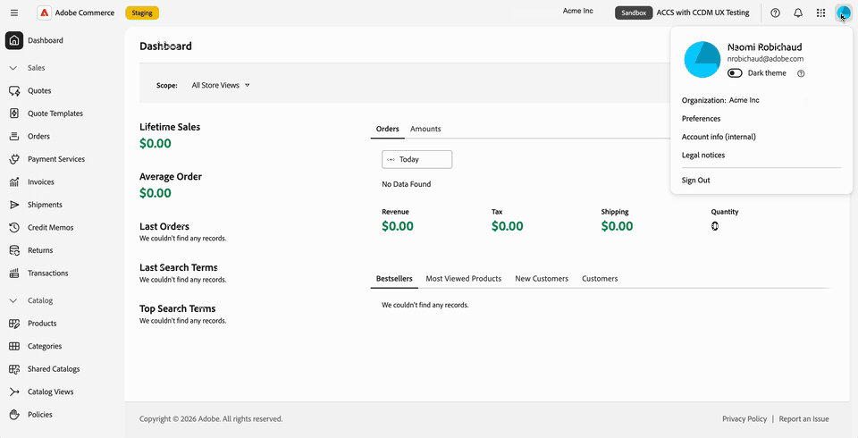

# Administrador do Commerce na experiência unificada da Adobe

O Commerce Admin for Adobe Commerce as a Cloud Service é aberto na Experiência unificada do Adobe quando você seleciona um nome de instância no Commerce Cloud Manager.

A interface da Experiência unificada da Adobe fornece a navegação superior compartilhada usada em produtos da Adobe, uma navegação à esquerda atualizada e um estilo de página de Administrador atualizado.

Você pode alternar entre organizações, produtos e instâncias do Commerce e acessar ajuda, notificações e preferências da conta na navegação superior. Suas permissões de função existentes no Commerce continuam a determinar quais itens de menu de Administrador você pode acessar.

>[!NOTE]
>
>O Administrador do Commerce na Experiência unificada do Adobe está disponível somente para o Adobe Commerce as a Cloud Service. Os clientes locais do Adobe Commerce na infraestrutura em nuvem e do Adobe Commerce continuam a usar a [interface clássica de administrador do Commerce](admin.md).

{width="800" zoomable="yes" border="light"}

## Abra o administrador do Commerce

Depois de entrar na [Adobe Experience Cloud](https://experience.adobe.com/){target="_blank"}, abra o Commerce Cloud Manager. Em seguida, selecione uma instância para abrir o Administrador na Experiência unificada.

O fluxo de logon permite mover-se entre instâncias do Commerce sem fazer logon separadamente em cada instância.
Você pode mover entre produtos da Adobe e instâncias do Commerce sem outros prompts de logon.

Para obter o procedimento de acesso, consulte [Acessar uma instância](https://experienceleague.adobe.com/en/docs/commerce/cloud-service/getting-started#access-an-instance){target="_blank"} no _Guia do Adobe Commerce as a Cloud Service_.
<!--

>[!BEGINTABS]

>[!TAB Open the Admin from Commerce Cloud Manager]

-->
{width="800" zoomable="yes" border="light"}

<!--
>[!TAB See it in action]

{width="800" zoomable="yes" border="light"}

>[!ENDTABS]

-->
### Escolher uma interface de administrador {#classic-ui}

Na versão inicial do Administrador do Commerce na experiência unificada, o Adobe Commerce as a Cloud Service oferece suporte a duas experiências de Administrador do Commerce, a Experiência unificada do Adobe e a Interface clássica.

Por padrão, ao selecionar uma instância do Commerce no Commerce Cloud Manager, o Administrador do Commerce é aberto na Experiência unificada do Adobe. Para voltar para a interface clássica, use um marcador existente ou localize o URL da interface clássica. Consulte [Abrir interface clássica](#open-classic-ui).

Os links para a Experiência unificada e a Interface clássica estão disponíveis no painel de detalhes da instância no Commerce Cloud Manager.

| Link | Experiência |
| --- | --- |
| **[!UICONTROL Admin URL (Unified Shell UI)]** | Abre o Administrador na Experiência unificada. |
| **[!UICONTROL Admin URL (Classic UI)]** | Abre a interface Admin anterior. |

{width="800" zoomable="yes" border="light"}

_Ilustração baseada na captura de tela da lista de instâncias e no design atualizado dos detalhes da instância. As URLs mostradas usam hosts de preparo._

#### Formatos de URL

| Experiência | Padrão de URL |
| --- | --- |
| Experiência unificada | `https://<experience-cloud-host>/#/@<organization>/in:<instance-id>/commerce/cloud-service/admin` |
| Interface clássica | `https://<commerce-admin-host>/<instance-id>/admin/` |

A Experiência Unificada identifica a organização após `@` e a instância após `in:`. A interface clássica coloca a ID da instância diretamente após o nome do host.

Por exemplo, esses URLs de preparo abrem a mesma instância:

- **Experiência Unificada**: `https://experience-stage.adobe.com/#/@adobe-commerce-uex/in:<instance-id>/commerce/cloud-service/admin`
- **Interface Clássica**: `https://na1-stage.admin.commerce.adobe.com/<instance-id>/admin/`

Esses nomes de host de preparo não são URLs de produção. Sempre use os links de instância do Commerce Cloud Manager em vez de construir URLs.

#### Abrir interface clássica

Para abrir a interface clássica:

- Use um marcador ou URL do administrador clássico existente. Esses URLs só abrem a interface clássica e não redirecionam para a Experiência unificada.
- Selecione **[!UICONTROL Admin URL (Classic UI)]** nos detalhes da instância do Commerce Cloud Manager.

Não há switch de interface dentro do Admin. Use o Commerce Cloud Manager ou um URL de administrador salvo para retornar à interface clássica se necessário.

## Identificar a organização e a instância

Antes de fazer alterações, verifique a organização e a instância em que você está trabalhando:

- O menu de contas mostra sua organização atual.
- O alternador de instâncias na navegação superior mostra o nome da instância e um selo **[!UICONTROL Production]** ou **[!UICONTROL Sandbox]**.

Use o selo do ambiente para distinguir uma instância de produção de uma sandbox ao alternar entre instâncias.

## Alternar organizações, produtos e instâncias

A navegação superior fornece controles separados para alternar o contexto de trabalho.

### Alternar organizações

Use o alternador de organização na navegação superior para se mover entre as organizações às quais você tem acesso.

1. Na navegação superior, selecione o nome da organização.

1. Selecione uma organização na lista.

   A lista mostra as organizações às quais você tem acesso. Uma marca de seleção identifica a organização em que você está trabalhando.

>[!BEGINTABS]

>[!TAB Seletor de organização]

{width="800" zoomable="yes" border="light"}

>[!TAB Veja-o em ação]

{width="800" zoomable="yes" border="light"}

>[!ENDTABS]

O menu conta também mostra em qual organização você está trabalhando. Selecione a imagem do seu perfil ({width="24"}) na navegação superior e verifique a linha **[!UICONTROL Organization]**.

{width="800" zoomable="yes" border="light"}

As instâncias que você pode abrir pertencem à organização em que está trabalhando. Para alterar instâncias, consulte [Alternar instâncias do Commerce](#switch-commerce-instances).

### Alternar produtos

Use o alternador de produto ({width="24"}) na navegação superior para alterar aplicativos a qualquer momento. Funciona da mesma forma que em outros produtos da Adobe.

- **Admin Console**: abra o Adobe Admin Console no alternador de produtos para gerenciar usuários e seus acessos (**[!UICONTROL Administer]** > **[!UICONTROL Users]**). Não é necessário lembrar o URL. O Adobe Admin Console é separado do Administrador do Commerce, onde você gerencia sua loja.
- **Adobe Exchange**: encontre extensões, plug-ins, scripts e integrações corporativas de terceiros na Adobe Creative Cloud, Adobe Experience Cloud e Adobe Document Cloud.
- **Outros produtos**: abra produtos como o Colaborador.

>[!BEGINTABS]

>[!TAB Menu do alternador de produto]

{width="800" zoomable="yes" border="light"}

>[!TAB Veja-o em ação]

{width="800" zoomable="yes" border="light"}

>[!ENDTABS]

Para o gerenciamento de usuários e funções do Adobe Commerce as a Cloud Service, consulte [Gerenciamento de usuários](https://experienceleague.adobe.com/en/docs/commerce/cloud-service/user-management){target="_blank"}.

### Alternar instâncias do Commerce

A navegação superior inclui um botão de alternador de instância. Ele sempre mostra o emblema **[!UICONTROL Production]** ou **[!UICONTROL Sandbox]** e o nome da instância em que você está.

1. Na navegação superior, selecione o alternador de instâncias que exibe o nome da instância atual e o selo de ambiente.

1. Selecione uma instância na lista.

   A lista contém as instâncias do Adobe Commerce as a Cloud Service que você pode acessar na organização atual. Não é necessário retornar ao Commerce Cloud Manager para alternar instâncias, para que você possa avançar e retroceder entre instâncias.

1. Verifique o nome da instância e o selo do ambiente antes de continuar seu trabalho.

A instância faz parte do URL da página, portanto, você pode marcar ou compartilhar um link que abra uma instância específica. Se você abrir o Admin sem uma instância no link, ele carregará a última instância usada.

## Use a navegação à esquerda

O menu Admin do Commerce é exibido na navegação à esquerda da Experiência unificada da Adobe. Expanda ou recolha as seções de menu para encontrar as ferramentas necessárias ou digite para ir para um item de menu.

O menu é específico para a instância em que você está trabalhando. Ao alternar instâncias, a navegação à esquerda é atualizada para corresponder.

Suas permissões de função existentes continuam. Você vê somente os itens de menu permitidos pela sua função.

Continue a usar o Guia de administração para tarefas como gerenciar produtos, pedidos, clientes e configuração. As páginas de administrador atualizaram o estilo, portanto, sua aparência pode ser diferente das capturas de tela da interface clássica neste guia.

>[!BEGINTABS]

>[!TAB Navegação à esquerda do administrador do Commerce]

{width="800" zoomable="yes" border="light"}

>[!TAB Veja-o em ação]

{width="800" zoomable="yes" border="light"}

>[!ENDTABS]

## Obter ajuda e fornecer feedback

Para acessar os recursos sem sair do Administrador do Commerce, abra o painel de ajuda usando o ícone de ajuda ({width="24"}) na navegação superior.

- **Ajuda**: pesquise a documentação da Adobe Experience League diretamente do painel.
- **Suporte**: acesse os fóruns da comunidade e outros recursos de aprendizado e encontre seus tíquetes de suporte na Adobe Experience League.
- **Feedback**: envie um feedback ao Adobe a partir do mesmo painel.

Ajuda, suporte e feedback estão disponíveis em contexto. Você permanece no Administrador do Commerce e não perde seu lugar.

>[!BEGINTABS]

>[!TAB Painel de ajuda]

{width="800" zoomable="yes" border="light"}

>[!TAB Veja-o em ação]

{width="800" zoomable="yes" border="light"}

>[!ENDTABS]

## Exibir notificações {#view-notifications}

Para exibir notificações, solicitações e anúncios de produtos em um contexto, abra o painel de notificações usando o ícone de sino ({width="24"}) na navegação superior.

O painel reúne os seus **[!UICONTROL Requests]**, **[!UICONTROL Notifications]** e **[!UICONTROL Announcements]** em um único local. Não é necessário sair do administrador do Commerce para ver nenhum deles.

Use o ícone de sino na navegação superior da Experiência unificada para este painel, em vez do controle de notificação no cabeçalho da página do Commerce. Para obter instruções sobre as mensagens da caixa de entrada de administração do Commerce, consulte [Caixa de entrada de mensagens](admin-message-inbox.md).

>[!BEGINTABS]

>[!TAB Painel de notificações]

{width="800" zoomable="yes" border="light"}

>[!TAB Veja-o em ação]

{width="800" zoomable="yes" border="light"}

>[!ENDTABS]

## Gerenciar preferências da conta

Selecione sua imagem de perfil ({width="24"}) na navegação superior para abrir o menu de conta. Nesse menu, é possível:

- Exibir a organização na qual você está trabalhando.
- Ative o modo escuro com a alternância **[!UICONTROL Dark theme]**.
- Abra as preferências do usuário.

>[!BEGINTABS]

>[!TAB Menu Conta com modo escuro]

{width="800" zoomable="yes" border="light"}

>[!TAB Veja-o em ação]

{width="800" zoomable="yes" border="light"}

>[!ENDTABS]

## Estilo de página atualizado

As páginas no Administrador do Commerce têm uma aparência atualizada que corresponde à Experiência unificada do Adobe. Mais restyling está planejado para versões posteriores.

>[!MORELIKETHIS]
>
>[guia de administração e interface do Adobe CX Enterprise](https://experienceleague.adobe.com/en/docs/core-services/interface/experience-cloud)
