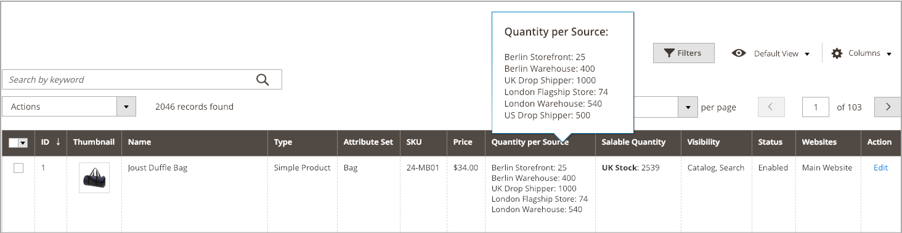

# Gerenciar quantidades de estoque

Use as diretrizes a seguir para atribuir origens e quantidades a produtos novos ou existentes.

Ao criar produtos, atribua origens e quantidades durante a criação do produto. Consulte [Criar um produto](../catalog/product-create.md) para obter instruções completas. Essas páginas incluem informações de origem única e de várias origens para origens e quantidades por origem.

Ao acessar pela primeira vez um [!DNL Commerce] atualizado com [!DNL Inventory Management], todos os produtos e quantidades são atribuídos ao Source Padrão. Ao importar novos produtos por meio do arquivo .csv, eles também são atribuídos ao Source padrão.

Comerciantes de uma ou várias origens podem atualizar origens, quantidades de inventário e limites por produto ou em massa.

- Os comerciantes de origem única podem atualizar quantidades de produtos para o Source Padrão. Essa quantidade é o número total de produtos disponíveis para venda.

- Os comerciantes de várias origens podem atribuir várias origens e quantidades por produto para cada local (depósitos, lojas, entregadores diretos e assim por diante). Recomenda-se adicionar origens antes de definir os valores de inventário do produto.

Ao adicionar origens e quantidades aos seus produtos, é possível exibir as quantidades por meio da Grade de Produtos. Se você tiver um número alto de origens, passe o mouse sobre _[!UICONTROL Quantity per Source]_para ver a lista completa e rolável de origens com quantidades atuais.

{width="600" zoomable="yes"}

Você tem as seguintes opções para atribuir inventário a produtos:

- [Atribuindo origens por produto](sources-assign-per-product.md) - Atribua origens manualmente por produto no catálogo.

- [Atribuindo Quantidades por Produto](quantities-assign-per-product.md) - Adicione os valores de estoque disponíveis aos seus produtos por origem. Essas informações são específicas para comerciantes de várias origens.

- [Atribuição e cancelamento de atribuições em massa de origens](bulk-assignment.md) - Atribua origens a produtos selecionados como uma ação em massa. Use a opção [Transferir inventário para o Source](inventory-transfer.md) se desejar transferir o inventário e remover a origem.

- [Transferindo o Estoque para o Source](inventory-transfer.md) - Transfira em massa todo o estoque de uma origem para uma origem de destino.

- [Importando e Exportando Quantidades](inventory-import-export.md) - Use recursos de importação e exportação para atualizar várias SKUs de produtos com origens e quantidades de estoque.
